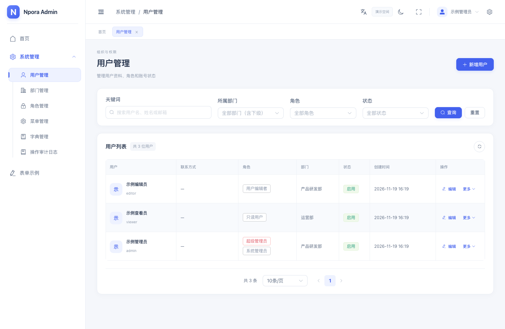
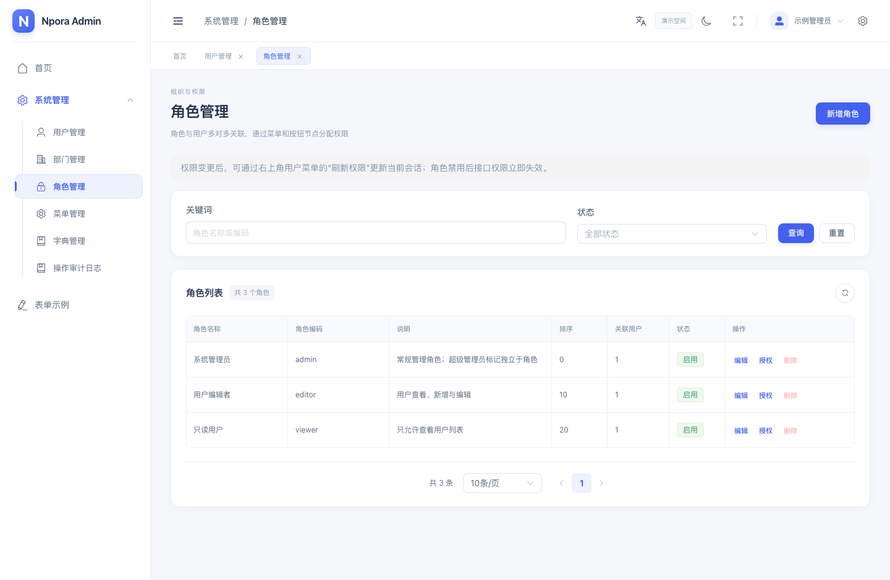

# Npora Admin Template

基于 Vue 3、TypeScript、Element Plus、Pinia 和 Vite 的后台脚手架。提供动态菜单与搜索、按钮权限、系统管理、会话与审计，以及可配置的主题、菜单布局和页签样式。

[](https://admin.npora.live)

[在线展示](https://admin.npora.live) · [页面截图](docs/showcase/README.md) · [演示 API 健康检查](https://api.npora.live/health)

演示账号：`admin`，密码：`123456`。体验改密、验证器绑定或会话撤销时，请使用自己创建的测试账号。

## 界面预览

<details>
<summary>查看静态截图：登录、首页、用户管理、角色管理和操作审计</summary>

| 登录页                                                        | 后台首页                                                                |
| ------------------------------------------------------------- | ----------------------------------------------------------------------- |
| [](docs/showcase/login.png) | [](docs/showcase/dashboard.png) |






</details>

## 快速开始

建议使用 Node.js 24 LTS。创建时可选择 npm、pnpm 或 Yarn 安装依赖。

```sh
npx @npora/create-admin@latest my-admin --yes --install npm
cd my-admin
```

| 预设              | 适用场景                            |
| ----------------- | ----------------------------------- |
| `starter`（默认） | 核心前端和 MySQL 脚本，对接已有后端 |
| `worker`          | 核心前端和独立 Worker 后端参考实现  |
| `demo`            | 完整展示和业务示例                  |

纯净版保留 `src/`、`public/`、MySQL 脚本及独立构建所需的配置、文档和测试。生成项目不包含演示页面、Workers 或部署工具。`VITE_AUTHENTICATOR_ENABLED` 默认关闭。启动前，按 [MySQL 初始化说明](database/mysql/README.md) 准备数据库，在自有后端初始化首个管理员，并在 `.env.development` 设置 `VITE_API_URL`。后端就绪后，运行 `npm run dev`，用刚创建的管理员账号登录。

## 使用指南

- [会话管理与权限预览](docs/account-management.md) · [登录、改密和 Google Authenticator](docs/authentication.md)
- [接口契约与操作审计](docs/api.md) · [权限模型](docs/rbac.md) · [MySQL 初始化和升级](database/mysql/README.md)
- [开发配置](docs/development.md) · [新增业务页面](docs/new-business-page.md) · [目录职责](docs/project-structure.md)
- [应用设置、菜单搜索与缓存](docs/development.md#本地偏好与缓存)
- [生成器参数](https://github.com/npora/create-admin) · [npm 包](https://www.npmjs.com/package/@npora/create-admin)

## 本仓库开发

`npm ci` 安装依赖，`npm run dev` 按 `.env.development` 和本机开关启动开发服务，`npm run dev:demo` 启动完整展示。提交前运行 `npm run check:all`。[开发检查](docs/development.md) · [预设与构建](scaffold/README.md)
