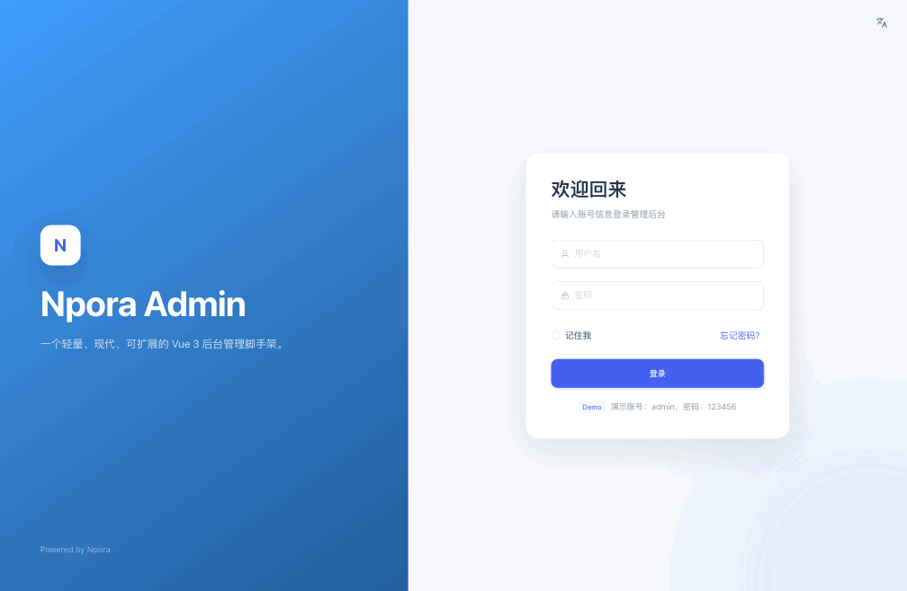
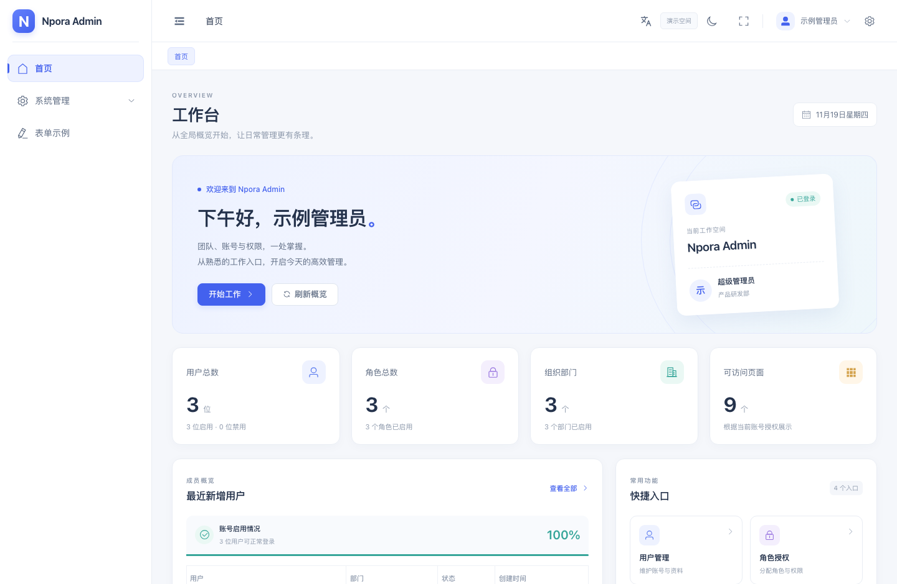
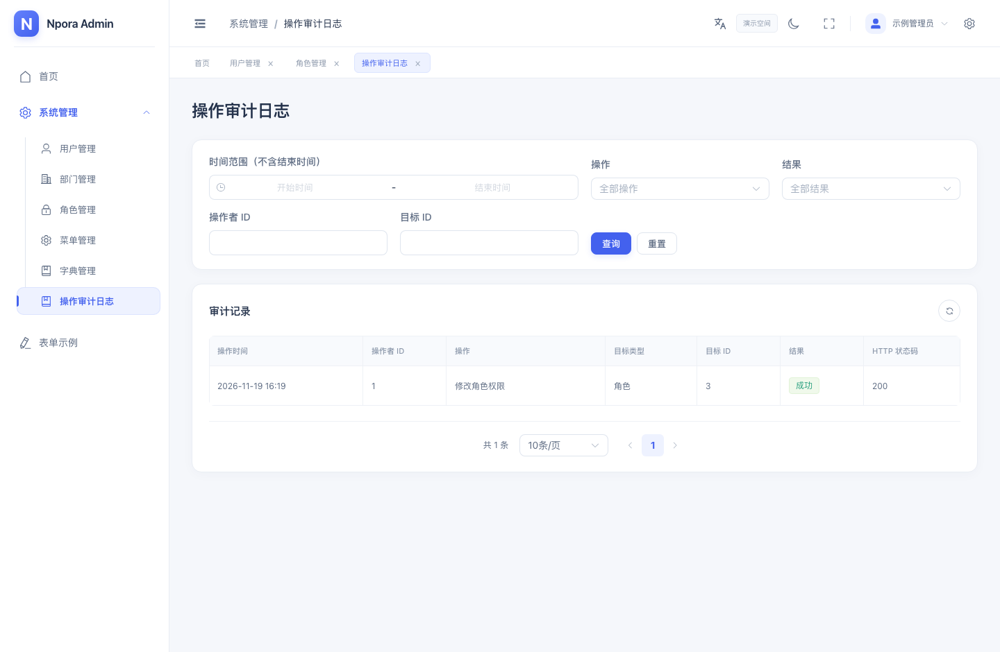

# Npora Admin Template

基于 Vue 3、TypeScript、Element Plus、Pinia 和 Vite 的后台脚手架。提供动态菜单与搜索、按钮权限、系统管理、会话与审计，以及可配置的主题、菜单布局和页签样式。

[](https://admin.npora.live)

[Npora 官网](https://www.npora.live/) · [Vue 在线演示](https://admin.npora.live/) · [React 在线演示](https://react.npora.live/) · [页面截图](docs/showcase/README.md)

演示账号：`admin`，密码：`123456`。体验改密、验证器绑定或会话撤销时，请使用自己创建的测试账号。

GIF 使用隔离示例数据。公开演示通过 [Npora Online](https://github.com/npora/online/tree/main/vue) 构建和部署。本仓库仅交付 Vue 纯净前端及正式 MySQL 初始化和迁移脚本；演示 API、演示数据和部署配置由线上仓库维护。

## 界面预览

<details>
<summary>查看静态截图：登录、首页、用户管理、角色管理和操作审计</summary>

| 登录页                                                        | 后台首页                                                                |
| ------------------------------------------------------------- | ----------------------------------------------------------------------- |
| [](docs/showcase/login.png) | [](docs/showcase/dashboard.png) |




</details>

## 快速开始

建议使用 Node.js 24 LTS。创建时可选择 npm、pnpm 或 Yarn 安装依赖。

```sh
npx @npora/create-admin@latest my-admin --yes --framework vue --install npm
cd my-admin
```

生成器支持 Vue 和 React 两种纯净模板；交互运行时可选择框架，也可用 `--framework vue` 或 `--framework react` 指定。本仓库对应 Vue 模板。生成项目包含核心前端、MySQL 脚本及独立构建所需的配置、文档和测试。`VITE_AUTHENTICATOR_ENABLED` 默认关闭。启动前，按 [MySQL 初始化说明](database/mysql/README.md) 准备数据库，在自有后端初始化首个管理员，并在 `.env.development` 设置 `VITE_API_URL`。后端就绪后，运行 `npm run dev`，用刚创建的管理员账号登录。

## 使用指南

- [会话管理与权限预览](docs/account-management.md) · [登录、改密和 Google Authenticator](docs/authentication.md)
- [接口契约与操作审计](docs/api.md) · [权限模型](docs/rbac.md) · [MySQL 初始化和升级](database/mysql/README.md) · [SQL 在线指南](https://admin.npora.live/database/)
- [开发配置](docs/development.md) · [新增业务页面](docs/new-business-page.md) · [目录职责](docs/project-structure.md)
- [应用设置、菜单搜索与缓存](docs/development.md#本地偏好与缓存)
- [生成器参数](https://github.com/npora/create-admin) · [npm 包](https://www.npmjs.com/package/@npora/create-admin)

## 本仓库开发

`npm ci` 安装依赖。启动自己的 API 后，运行 `npm run dev`，开发服务按 `.env.development` 连接后端。提交前运行 `npm run check:all`。[开发检查](docs/development.md)
