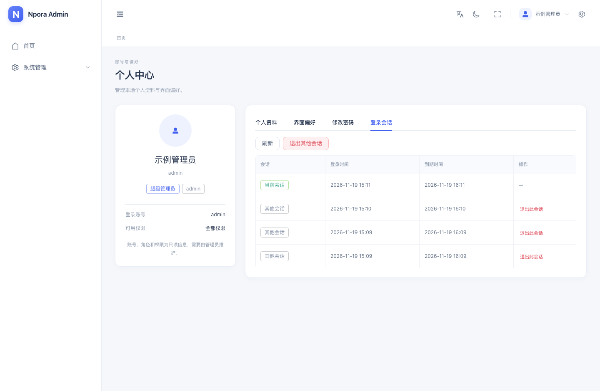
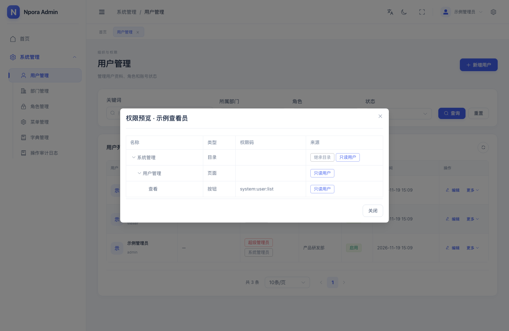
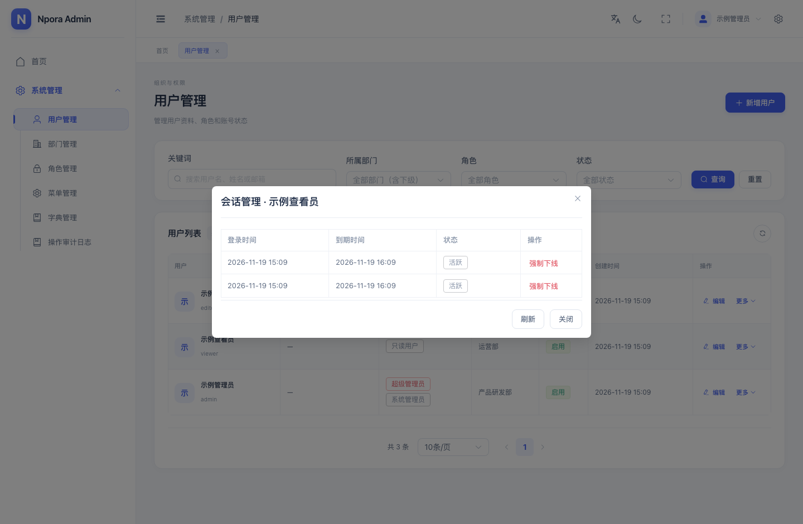

# 会话管理与权限预览

## 查看自己的登录会话

在 **个人中心 → 登录会话** 查看登录时间和到期时间。列表会标记当前会话，可以撤销单个其他会话，也可以退出全部其他会话。被撤销的会话在下次访问受保护接口时失效，当前会话仍可使用。要退出当前会话，使用右上角账号菜单中的退出登录。

使用两个独立浏览器或浏览器配置登录同一测试账号，即可体验撤销效果。公开演示账号的会话操作受保护，体验撤销时请使用自己创建的测试账号。

## 预览用户权限

在 **系统管理 → 用户管理 → 更多 → 权限预览** 查看目标用户实际生效的菜单和按钮权限。直接授权会列出来源角色，依赖子项出现的目录会标记为继承，独立超级管理员权限会单独标明。停用账号没有生效权限。

查询需要 `system:user:permission-preview`。

## 管理其他用户的会话

在 **系统管理 → 用户管理 → 更多 → 会话管理** 查看目标用户的活跃会话。查看需要 `system:user-session:list`，撤销还需要 `system:user-session:revoke`。管理员可以撤销指定会话。当前会话和其他超级管理员的会话受保护。撤销结果记录在操作审计日志中。

会话列表只返回随机管理 ID、登录时间、到期时间和当前会话标记。界面只展示时间和状态。

## 接入

Worker 版和展示版应用 `0012_session_management.sql`。纯净版通过自有后端实现 [接口契约](api.md#会话管理与权限预览)，相关 MySQL 增量文件见 [正式 SQL](../database/mysql/README.md)。新增查看、预览或撤销能力后，为相应角色授予独立权限。
